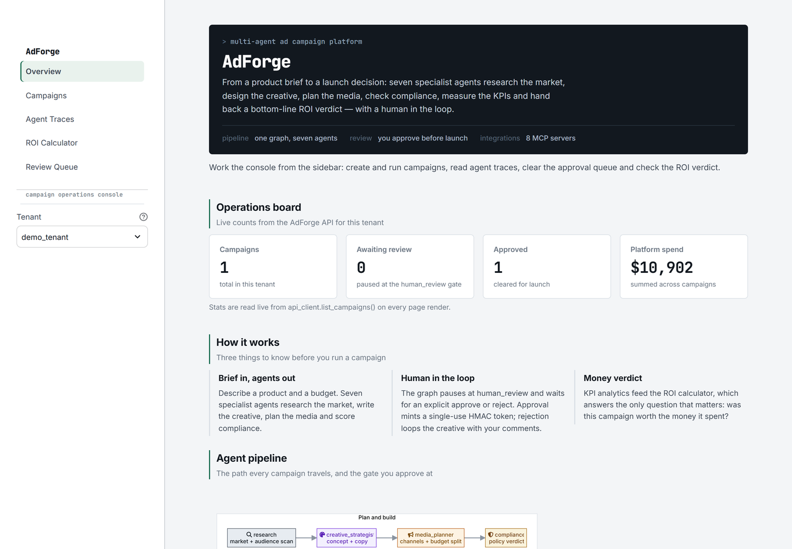
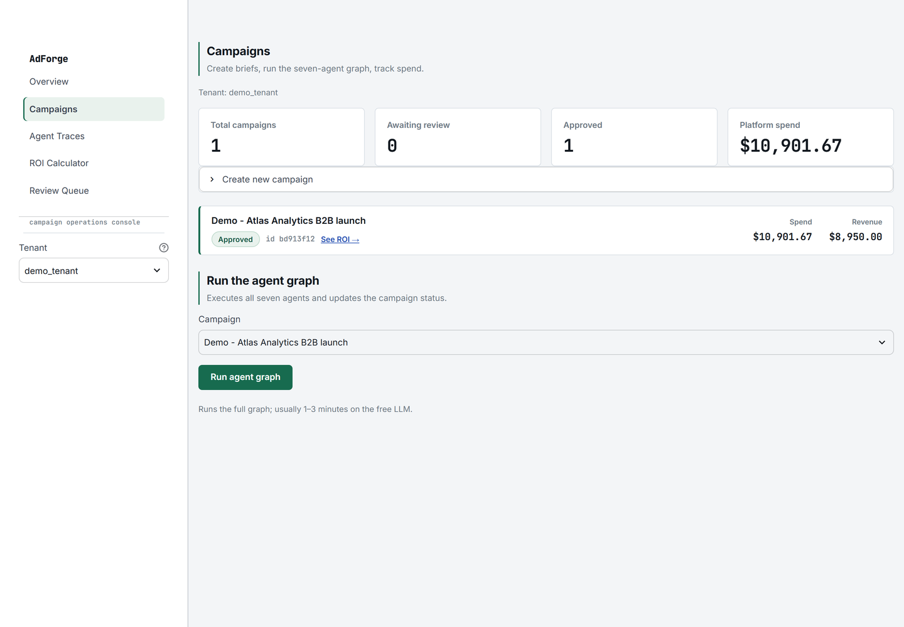
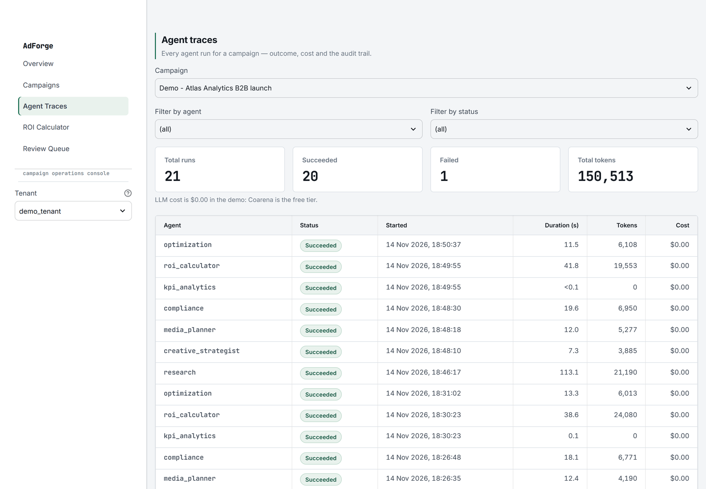
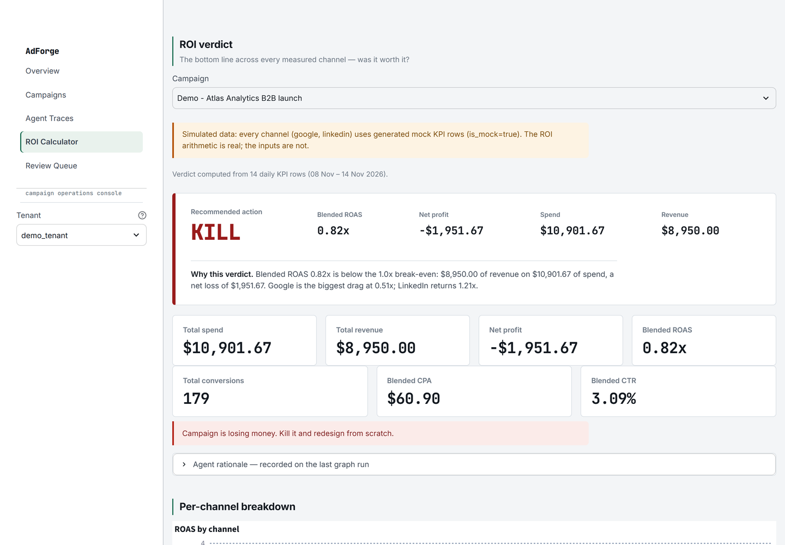
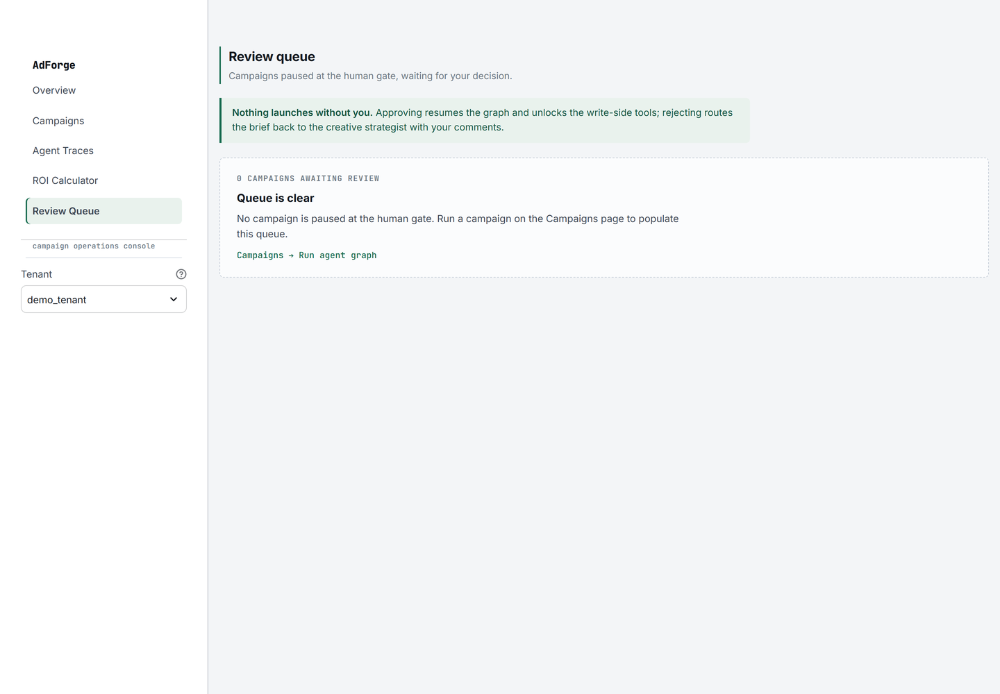
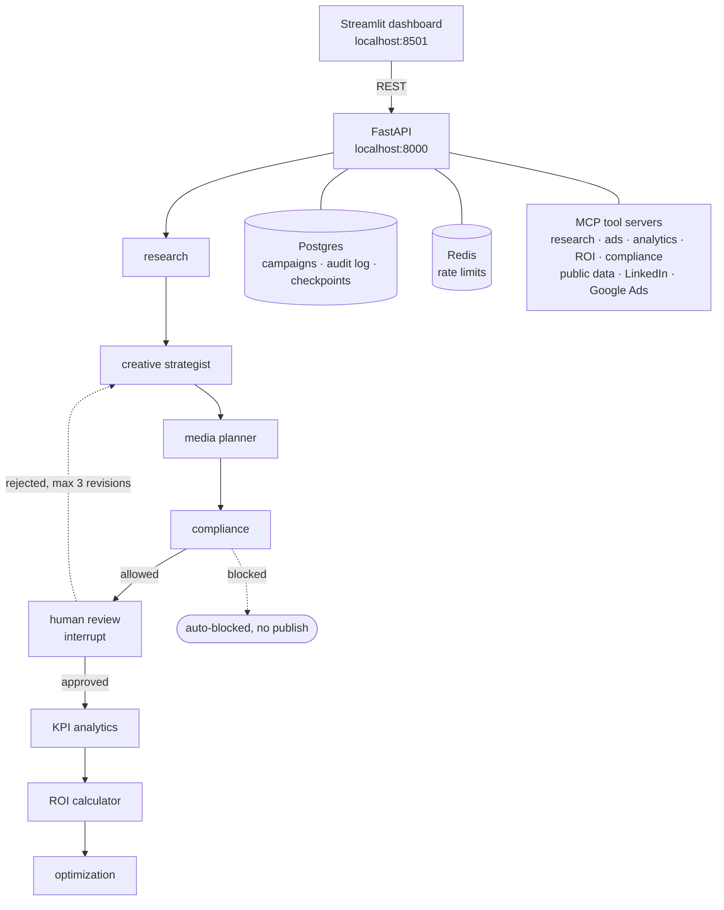

# AdForge

**End-to-end multi-agent ad campaign platform.** Brief → research → creative →
media plan → compliance → human approval → measurement → ROI verdict.

Seven specialist agents on a LangGraph state machine. Each one owns a dedicated
MCP tool server. Every agent boundary is a typed Pydantic contract, and every
decision lands in an append-only audit log.



---

## What it does

You give it a campaign brief. It:

1. **Researches** the market, competitors, keywords and audience — from free,
   keyless public sources (Wikipedia, DuckDuckGo/Bing, Google Trends, SEC
   EDGAR, Hacker News, Reddit, StackExchange, App Store, IPInfo).
2. **Designs** ad creative concepts with A/B variants, held to per-channel
   character limits.
3. **Plans media** — channel mix, budget split, bidding strategy, targeting,
   flight dates.
4. **Reviews compliance** — `PolicyEnforcer` hard-blocks prohibited content and
   requires disclosures.
5. **Pauses for a human.** Nothing is published until a named reviewer approves.
6. **Pulls KPIs** and computes ROAS, CPA, payback and net profit from raw rows.
7. **Proposes optimizations** — scale, optimize, pause or kill, with a written
   rationale naming the biggest drag.

The dashboard answers one question: **was it worth it?**

---

## See it

| | |
|---|---|
|  |  |
| **Campaigns** — brief in, seven agents out, spend tracked | **Agent Traces** — every run's input, output, tokens and audit events |
|  |  |
| **ROI Calculator** — the verdict, per channel | **Review Queue** — the human gate before anything launches |

A narrated walkthrough video is attached to the
[`demo-v0.1` release](https://github.com/Kaustubh-Rathi/adforge/releases/tag/demo-v0.1).

---

## Architecture



Full system design with 13 diagrams: **[docs/DESIGN.md](docs/DESIGN.md)**.
Dependency audit (what we integrate vs. build): **[docs/RESEARCH.md](docs/RESEARCH.md)**.

---

## Quick start

`make` is not required. On Windows use the PowerShell blocks below; on Linux/macOS
either path works. Every command in **[docs/RUNNING.md](docs/RUNNING.md)** was
executed on a real machine before being written down.

**Prerequisites:** Python 3.11+, Docker Desktop.

```powershell
git clone https://github.com/Kaustubh-Rathi/adforge.git
cd adforge
python -m venv .venv
# Only needed if PowerShell blocks Activate.ps1; scoped to this shell.
Set-ExecutionPolicy -Scope Process -ExecutionPolicy Bypass
.\.venv\Scripts\Activate.ps1
pip install -e ".[dev,dashboard]"
cp .env.example .env
```

Set `APP_SECRET` and `LLM_API_KEY` in `.env` (a free
[Coarena](https://coarena.ai) key is enough). Then:

```powershell
# 1. Postgres + Redis, then seed three example campaigns (idempotent).
docker compose up -d postgres redis
.\.venv\Scripts\python.exe -m adforge.storage.seed

# 2. Terminal 1 — API
.\.venv\Scripts\python.exe -m uvicorn adforge.api.main:app --host 127.0.0.1 --port 8000 --reload

# 3. Terminal 2 — dashboard
.\.venv\Scripts\python.exe -m streamlit run adforge/dashboard/Overview.py --server.port=8501
```

Open <http://localhost:8501>. API docs at <http://localhost:8000/docs>.

Whole stack in one command instead:

```powershell
docker compose up -d --build
```

---

## Usage

### Through the dashboard

1. **Campaigns** → *Create new campaign* → fill the brief → **Run agent graph**.
2. The run pauses at the human gate. **Review Queue** → read the packet →
   approve as a reviewer from `APP_REVIEWER_ALLOWLIST`.
3. **Agent Traces** and **ROI Calculator** now show the completed campaign.

A full run takes 1–3 minutes on the free LLM tier.

### Through the API

```powershell
$h = @{ "X-AdForge-Tenant" = "demo_tenant"; "Content-Type" = "application/json" }

$body = @{
  name  = "Q1 SaaS launch"
  brief = @{
    product_name        = "Acme CRM"
    product_description = "Lightweight CRM for B2B sales teams."
    target_audience     = "Sales managers at 20-200 person B2B SaaS companies."
    budget_usd          = 25000
    duration_days       = 30
    business_objective  = "conversion"
    channels_hint       = @("google", "linkedin")
  }
} | ConvertTo-Json -Depth 5

$c = Invoke-RestMethod -Method Post http://127.0.0.1:8000/campaigns -Headers $h -Body $body

Invoke-RestMethod -Method Post "http://127.0.0.1:8000/campaigns/$($c.id)/run" `
  -Headers @{ "X-AdForge-Tenant" = "demo_tenant"; "X-AdForge-Campaign" = $c.id }
```

Every request needs `X-AdForge-Tenant`. There is no ambient tenant.

Full endpoint list and a PowerShell end-to-end: **[docs/RUNNING.md](docs/RUNNING.md)**.

---

## Guardrails

Every agent invocation passes through this package. Agents cannot bypass it.

1. **Typed contracts** — input and output validated against Pydantic models; a
   broken agent cannot corrupt downstream state.
2. **Tenant isolation** — `TenantScope` is threaded through every DB query, MCP
   call and cache key. Cross-tenant reads are covered by tests that assert they fail.
3. **Rate limiting** — per-tenant + per-campaign token buckets in Redis.
4. **Append-only audit log** — every LLM call, MCP tool call and guardrail
   firing is persisted. No UPDATE path exists.
5. **Compliance gate** — `PolicyEnforcer` hard-blocks prohibited terms. The
   orchestrator will not reach the publish tool without `approved=True`.
6. **Cost ceiling** — `GUARDRAILS_MAX_LLM_CALLS_PER_CAMPAIGN` (default 200)
   bounds spend per campaign.

These are enforced by default; disabling them is refused outside dev/test.

---

## Tech stack

| Layer | Choice |
|---|---|
| Orchestration | LangGraph + Postgres checkpointer (durable HITL resume) |
| Tools | Official `mcp` SDK + `langchain-mcp-adapters` |
| LLM | Any OpenAI-compatible endpoint (default: Coarena free tier); plus Anthropic and Z.ai GLM adapters |
| Storage | Postgres (async SQLAlchemy) + Redis |
| API | FastAPI + Uvicorn |
| Dashboard | Streamlit + Plotly |
| Ad platforms | `googleads/google-ads-mcp`, Pipeboard MCP family, custom LinkedIn wrapper |

---

## Development

```powershell
.\.venv\Scripts\ruff.exe check adforge tests           # lint
.\.venv\Scripts\ruff.exe format --check adforge tests
.\.venv\Scripts\mypy.exe adforge                        # strict
.\.venv\Scripts\python.exe -m pytest -m "not integration and not live"   # unit
.\.venv\Scripts\python.exe -m pytest -m "integration and not live"       # embedded Postgres
```

| Tier | Services | Count |
|---|---|---|
| Unit | fakeredis + scripted LLM double; no DB, no network | 647 |
| Integration | `embedded-postgres`, no Docker needed | 44 |
| Live | opt-in via `ADFORGE_LIVE_TESTS=1`; real LLM + ad APIs | opt-in |

CI runs lint and the unit tier (with a 90% coverage gate) on Python 3.11 and
3.12, and the integration tier on 3.11
([`.github/workflows/ci.yml`](.github/workflows/ci.yml)).

### Add a new agent

1. Create `adforge/agents/<name>/` with `__init__.py`, `persona.py`, `agent.py`.
2. Subclass `BaseAgent` — override `name`, `persona`, `build_messages`, `parse_response`.
3. Add a node to `adforge/graph/state.py` and wire the edges.

Details in **[docs/ADDING_AN_AGENT.md](docs/ADDING_AN_AGENT.md)**.

---

## Use cases and honest limits

**[docs/USE_CASES.md](docs/USE_CASES.md)** covers what AdForge is good for — B2B
launch planning, pre-flight compliance, agency multi-tenancy, "was it worth it"
reporting — and, in the same document, where it is the wrong tool.

Read the limits before adopting it:

- **There is no chat interface.** You drive it through the dashboard or REST API.
- **No ad-platform credentials ship with it.** Dev/test uses deterministic mock
  KPIs, every row marked `is_mock=true` and labelled in the UI. Live spend needs
  real Google/Meta/LinkedIn credentials.
- **The compliance check is a first-pass filter, not a legal opinion.** Keep a
  human in the loop; the HITL gate exists for that reason.
- **Tenant identity is a header, trusted from the caller.** Put it behind your
  own auth before exposing it to third parties.
- **It is an operator tool.** Setup needs Python, Docker and an `.env` file.
- Agent LLM prompts are tuned for ad copy. This is not a general reasoning benchmark.

---

## Configuration

All configuration is env-driven via `adforge/config.py`. See
[`.env.example`](.env.example) for the complete list. The settings that change
behaviour most:

| Env var | Default | Purpose |
|---|---|---|
| `APP_ENV` | `dev` | `dev` / `test` / `staging` / `prod` — affects guardrail strictness |
| `APP_SECRET` | (empty) | HMAC key for HITL approval tokens. **Required** outside dev |
| `APP_REVIEWER_ALLOWLIST` | (empty) | Comma-separated reviewer emails authorised to approve |
| `LLM_PROVIDER` | `opencode` | `opencode` / `glm` / `openai` / `anthropic` |
| `LLM_BASE_URL` | `https://coarena.ai/api/v1` | Any OpenAI-compatible endpoint |
| `LLM_MODEL` | `gpt-6-luna` | Fallback: `gemini-3-8-flash` |
| `LLM_API_KEY` | (empty) | Free Coarena key: `$5/day`, 30 req/min, 2 concurrent |
| `DATABASE_URL` | auto from `POSTGRES_*` | Postgres connection string |
| `REDIS_URL` | auto from `REDIS_*` | Redis connection string |
| `CHECKPOINTER_BACKEND` | `postgres` | `postgres` / `memory` / `none` |
| `MCP_ENABLED` | `true` | `false` runs agents LLM-only, with no tool access |
| `GUARDRAILS_MAX_LLM_CALLS_PER_CAMPAIGN` | `200` | Hard ceiling on LLM spend per campaign |

When a credential or endpoint is missing, AdForge fails with an explicit
configuration error. It never substitutes fabricated ad performance or a fake
publish success.

---

## License

MIT — see [LICENSE](LICENSE).
