# AdForge — System Design (Mermaid Diagrams)

This is the single source of truth for AdForge's architecture. Every diagram here is rendered as a Mermaid block — view this file in GitHub, GitLab, VS Code, or any markdown viewer that supports Mermaid.

## Table of contents

1. [High-level architecture](#1-high-level-architecture)
2. [Agent graph topology (with HITL)](#2-agent-graph-topology-with-hitl)
3. [End-to-end sequence (campaign run)](#3-end-to-end-sequence-campaign-run)
4. [HITL review sequence (approve / reject)](#4-hitl-review-sequence-approve--reject)
5. [MCP server topology + permissions](#5-mcp-server-topology--permissions)
6. [Permission / approval-token lifecycle](#6-permission--approval-token-lifecycle)
7. [Multi-tenant data isolation](#7-multi-tenant-data-isolation)
8. [LLM provider abstraction](#8-llm-provider-abstraction)
9. [Web-search provider chain (Tavily-free)](#9-web-search-provider-chain-tavily-free)
10. [Storage layer + checkpointing](#10-storage-layer--checkpointing)
11. [Docker-compose deployment topology](#11-docker-compose-deployment-topology)
12. [Feature-based repo structure](#12-feature-based-repo-structure)
13. [GobbleCube plan summary](#13-gobblecube-plan-summary)

---

## 1. High-level architecture

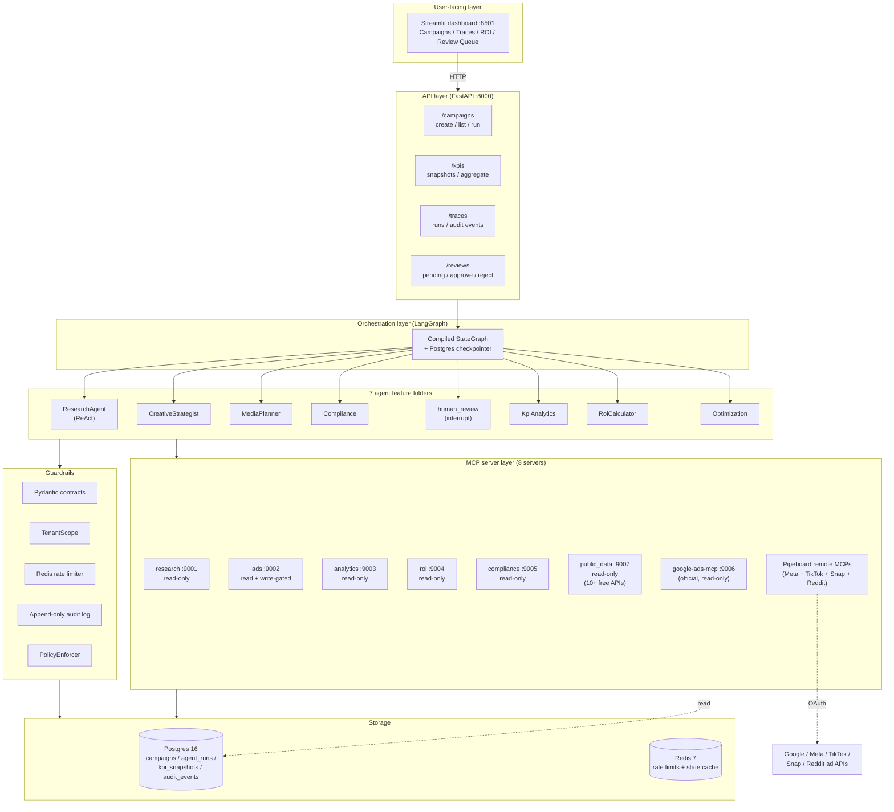

### What each layer is responsible for

| Layer | Responsibility | Cannot do |
|-------|---------------|-----------|
| UI (Streamlit) | Render campaign list, ROI charts, agent traces, review queue | Bypass API — every call goes through FastAPI |
| API (FastAPI) | Validate tenant header, route to graph, persist runs | Call MCPs directly (only orchestrator does) |
| Orchestration (LangGraph) | Decide node order, persist state, route on conditions | Skip guardrails — every node runs through BaseAgent |
| Agents | Domain logic — what to ask LLM, how to parse response | Bypass TenantScope or call write tools without approval |
| Guardrails | Contracts, isolation, rate limit, audit, policy | Make business decisions (only enforce rules) |
| MCPs | Wrap external APIs, enforce read-only / write-gated permissions | Make decisions — pure tool execution |
| Storage | Persist state, append-only audit log | Update audit_events (no UPDATE path exists) |

---

## 2. Agent graph topology (with HITL)

```mermaid
flowchart LR
    START((START)) --> Research[research_node<br/>ReAct agent<br/>iterates: search → scrape → cluster]
    Research --> Creative[creative_strategist_node<br/>produces CreativeConcept]
    Creative --> Media[media_planner_node<br/>produces MediaPlan]
    Media --> Comply[compliance_node<br/>runs PolicyEnforcer + LLM review]
    Comply --> Hitl{human_review_node<br/>uses interrupt()}
    Hitl -->|approved| Kpi[kpi_analytics_node<br/>fetches live KPIs via MCP]
    Hitl -->|skipped<br/>(dev mode)| Kpi
    Hitl -->|auto_blocked<br/>(critical risk)| END
    Hitl -->|rejected<br/>(revision < 3)| Creative
    Hitl -->|rejected<br/>(revision >= 3)| END
    Kpi --> Roi[roi_calculator_node<br/>produces RoiReport]
    Roi --> Opt[optimization_node<br/>max 3 suggestions]
    Opt --> END((END))

    classDef readonly fill:#e8f5e9,stroke:#2e7d32
    classDef gated fill:#fff3e0,stroke:#e65100
    classDef hitl fill:#fce4ec,stroke:#c2185b
    class Research,Creative,Media,Comply,Kpi,Roi,Opt readonly
    class Hitl hitl
```

### Edge routing rules

| From | Condition | To |
|------|-----------|----|
| START | always | research |
| research | always | creative_strategist |
| creative_strategist | always | media_planner |
| media_planner | always | compliance |
| compliance | always | human_review (interrupt) |
| human_review | reviewer approved | kpi_analytics |
| human_review | reviewer skipped (dev) | kpi_analytics |
| human_review | compliance critical risk | END (auto_blocked) |
| human_review | rejected, revision_count < 3 | creative_strategist (revise with comments) |
| human_review | rejected, revision_count >= 3 | END (blocked) |
| kpi_analytics | always | roi_calculator |
| roi_calculator | always | optimization |
| optimization | always | END |

---

## 3. End-to-end sequence (campaign run)

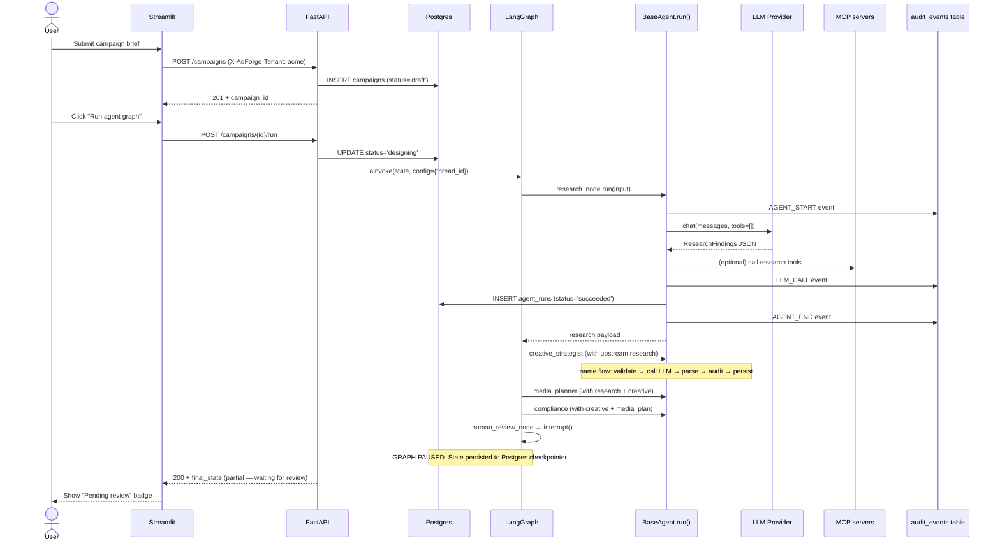

---

## 4. HITL review sequence (approve / reject)

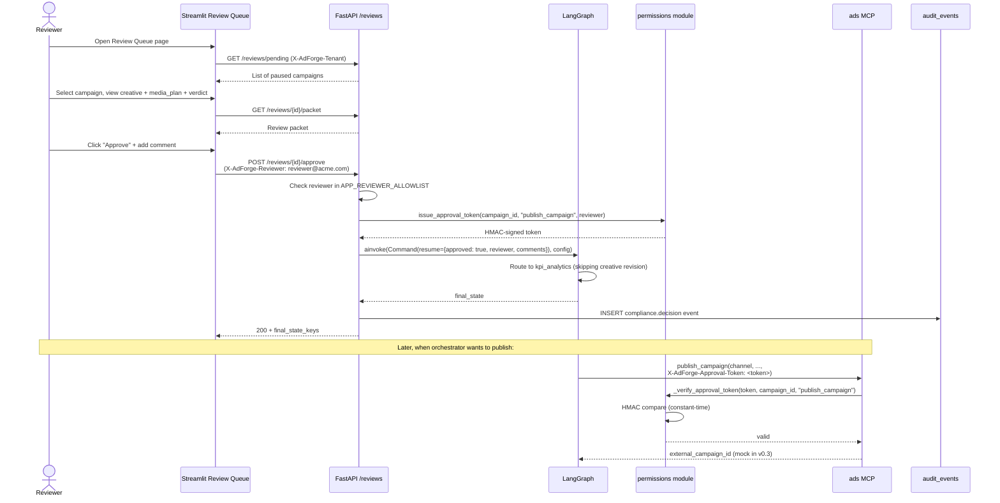

### Reject path (with revision loop)

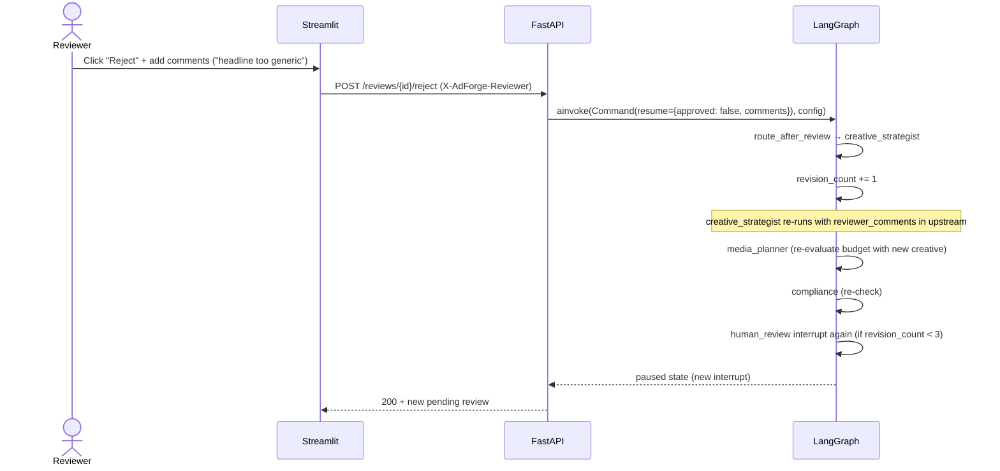

---

## 5. MCP server topology + permissions

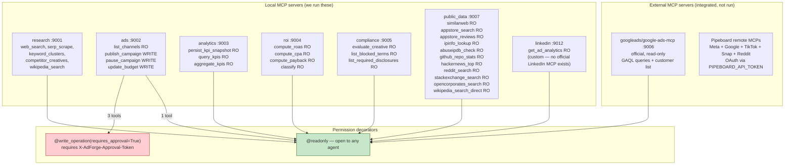

### Tool inventory (v0.3)

| Server | Total tools | Read-only | Write-gated |
|--------|------------|-----------|-------------|
| research | 5 | 5 | 0 |
| ads | 4 | 1 (`list_channels`) | 3 (`publish_campaign`, `pause_campaign`, `update_budget`) |
| analytics | 3 | 3 | 0 |
| roi | 4 | 4 | 0 |
| compliance | 3 | 3 | 0 |
| public_data | 11 | 11 | 0 |
| linkedin | 1 | 1 | 0 |
| google-ads-mcp (official) | 3 | 3 | 0 |
| Pipeboard remote | ~230 | (per their policy) | (per their policy) |
| **TOTAL** | **~264** | **~261** | **3** |

**Only 3 of ~264 tools are write-capable, and all 3 require a valid HMAC-signed approval token.**

---

## 6. Permission / approval-token lifecycle

```mermaid
stateDiagram-v2
    [*] --> NoToken : Campaign started

    NoToken --> TokenIssued : HITL reviewer approves<br/>issue_approval_token() called
    NoToken --> Blocked : Agent calls @write_operation<br/>tool without token

    Blocked --> [*] : Returns {error: approval_required}

    TokenIssued --> TokenUsed : Orchestrator calls<br/>publish_campaign with token
    TokenIssued --> TokenExpired : TTL (1h) elapsed

    TokenUsed --> [*] : Tool executes<br/>(TODO v0.4: blacklist in Redis<br/>to enforce single-use)
    TokenExpired --> [*] : Subsequent calls blocked

    note right of TokenIssued
        Token format:
        <campaign_id>:<operation>:<expires_at>:<hmac>#<reviewer_email>
        HMAC computed over first 3 fields
        with APP_SECRET as key
    end note
```

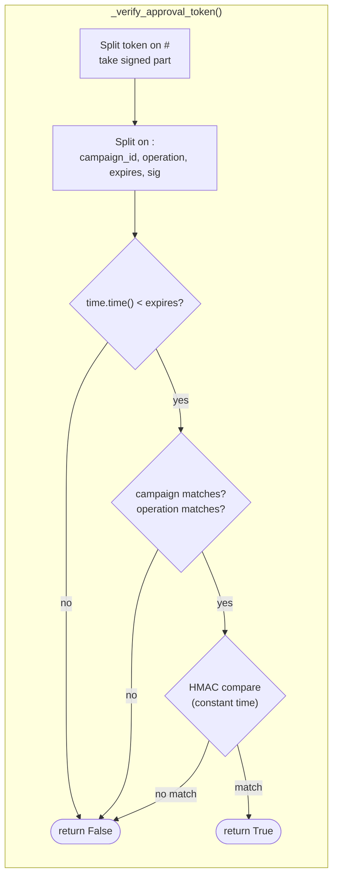

---

## 7. Multi-tenant data isolation

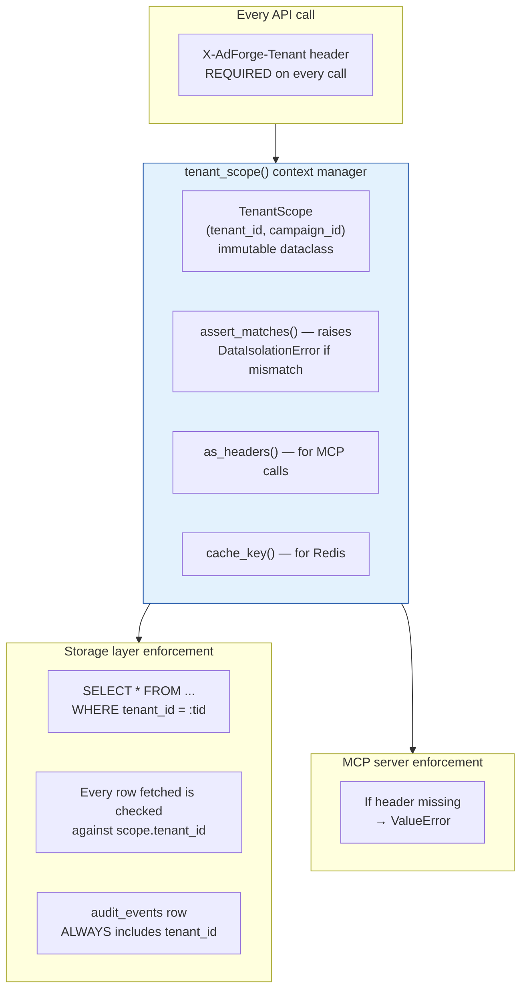

### Isolation guarantees

| Layer | Guarantee |
|-------|-----------|
| HTTP API | `X-AdForge-Tenant` header required on every call (returns 400 if missing) |
| LangGraph state | `tenant_id` + `campaign_id` set on first node, never mutated |
| BaseAgent.run() | Wraps every execution in `async with tenant_scope(...)` |
| Storage queries | Every SELECT filters `WHERE tenant_id = :tid` |
| MCP calls | Every call carries `X-AdForge-Tenant` header; server rejects if missing |
| Audit log | Every `audit_events` row includes `tenant_id` — can be queried per-tenant for compliance reviews |
| Approval tokens | HMAC includes campaign_id — token for tenant A's campaign cannot be used for tenant B |

---

## 8. LLM provider abstraction

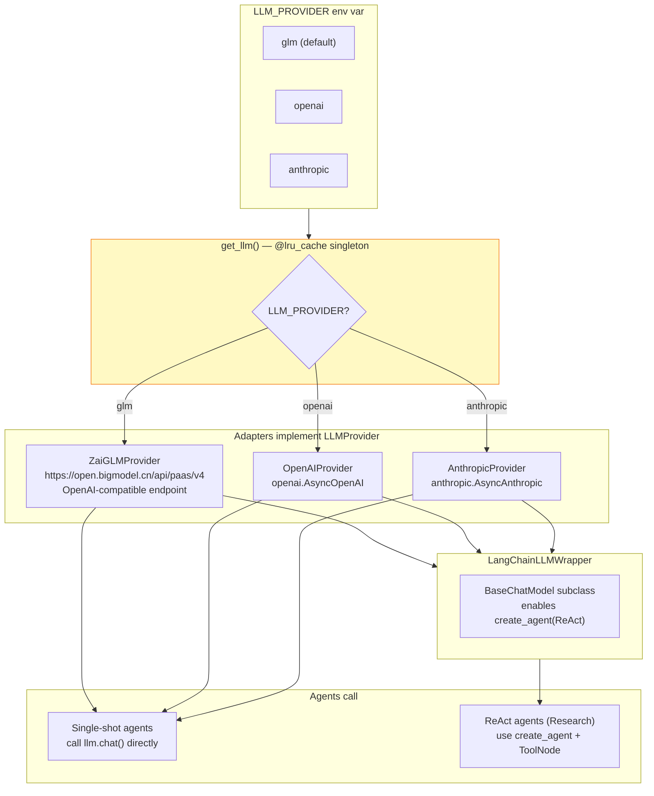

---

## 9. Web-search provider chain (Tavily-free)

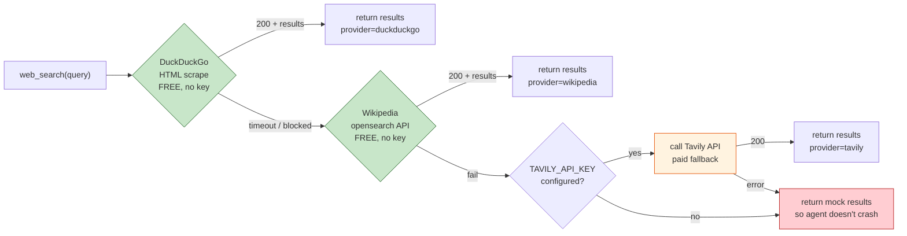

### Free public-data tool inventory

| Tool | API | Auth required | Rate limit |
|------|-----|---------------|------------|
| `web_search` (DDG path) | html.duckduckgo.com | None | None documented |
| `wikipedia_search` | en.wikipedia.org/w/api.php | None | Generous |
| `hackernews_top` | hacker-news.firebaseio.com | None | Unlimited |
| `reddit_search` | reddit.com/r/.../search.json | None (read-only) | ~60/min/IP |
| `stackexchange_search` | api.stackexchange.com | None | 300/sec no key |
| `appstore_search` | itunes.apple.com/search | None | ~20/min/IP |
| `appstore_reviews` | itunes.apple.com/.../rss | None | Generous |
| `opencorporates_search` | api.opencorporates.com | None | 100/day |
| `github_repo_stats` | api.github.com/repos | None (60/hr) or token (5000/hr) | 60/hr/IP |
| `ipinfo_lookup` | ipinfo.io | Optional token | 50k/mo free |
| `abuseipdb_check` | api.abuseipdb.com | Key required | 1k/day free |
| `similarweb_traffic` | api.similarweb.com (via Composio) | Key required | Free tier |

**Net result: the Research agent can run end-to-end with ZERO paid credentials.**

---

## 10. Storage layer + checkpointing

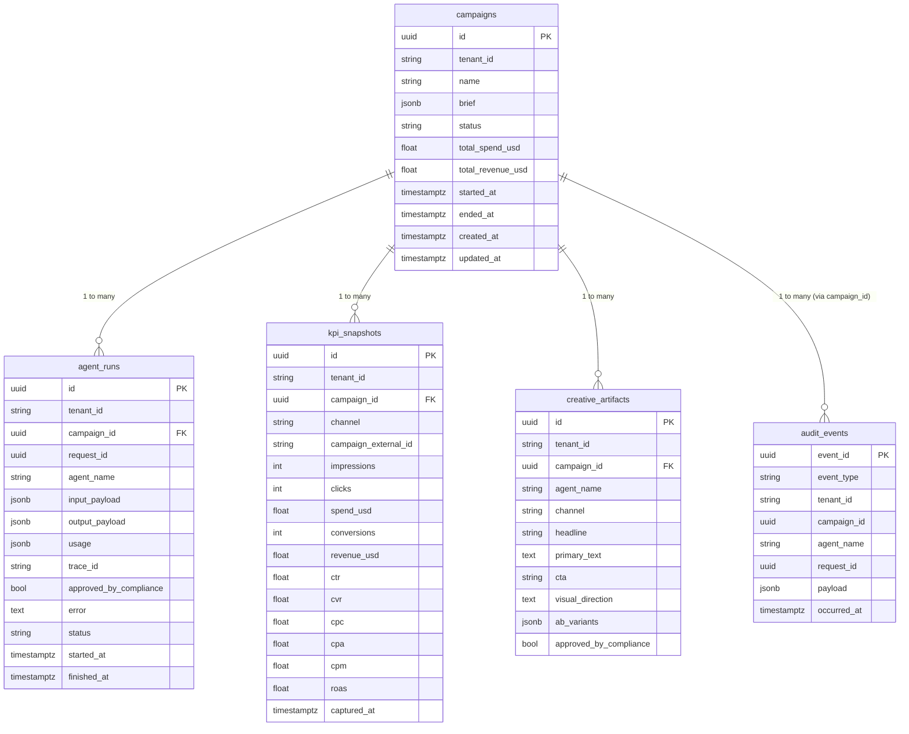

### Append-only invariant

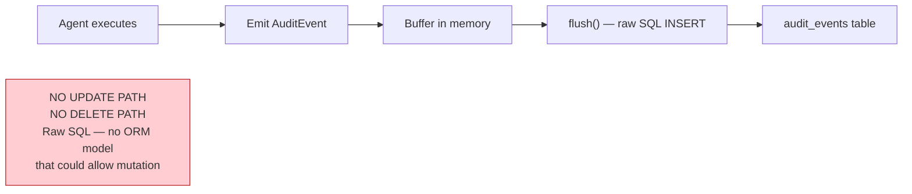

### LangGraph checkpointer

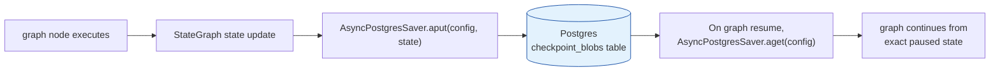

---

## 11. Docker-compose deployment topology

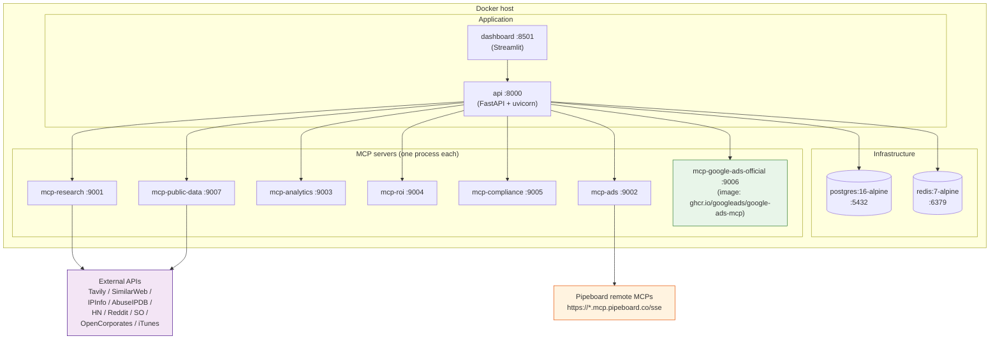

### Why this topology

| Decision | Reason |
|----------|--------|
| One container per MCP server | Distributes load — no single process carries the full tool surface |
| Postgres + Redis as separate containers | Standard managed equivalents in prod (RDS / ElastiCache) |
| Streamlit dashboard is single-container | Dev tool; replace with Next.js in prod |
| google-ads-mcp uses pre-built image | Avoids vendoring Google's code |
| Pipeboard MCPs are remote (not local containers) | OAuth handled by Pipeboard; we just call their SSE endpoint |

---

## 12. Feature-based repo structure

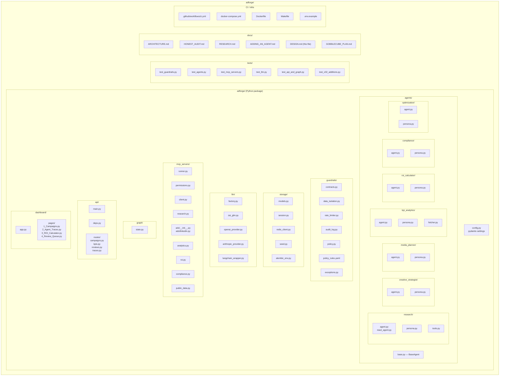

### Folder conventions

| Folder | Rule |
|--------|------|
| `adforge/agents/<name>/` | One folder per agent. Adding an agent = adding a folder. See `ADDING_AN_AGENT.md`. |
| `adforge/mcp_servers/` | One file per MCP server. AdForge-local servers only. |
| `adforge/guardrails/` | Imported by every other module. Never imports from agents/ or storage/. |
| `adforge/storage/` | ORM models + session. Imports from guardrails/ for tenant mixin. |
| `adforge/llm/` | Provider adapters. Never imports from agents/. |
| `adforge/graph/` | The compiled graph. Imports agents/. Agents never import graph/. |
| `adforge/api/routes/` | One file per resource. Routes import graph + storage + guardrails. |
| `adforge/dashboard/pages/` | Streamlit multipage convention. Each file = one sidebar entry. |

---

## 13. GobbleCube plan summary

> Full plan: [`docs/GOBBLECUBE_PLAN.md`](GOBBLECUBE_PLAN.md)

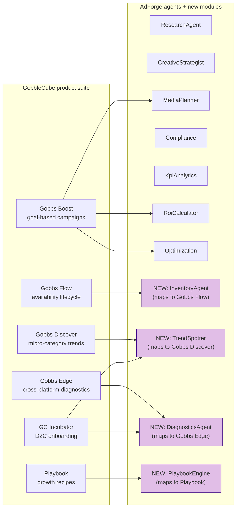

See `docs/GOBBLECUBE_PLAN.md` for the full mapping + 8-week build plan + new MCPs needed (e-commerce platform integrations, stock-availability APIs).
