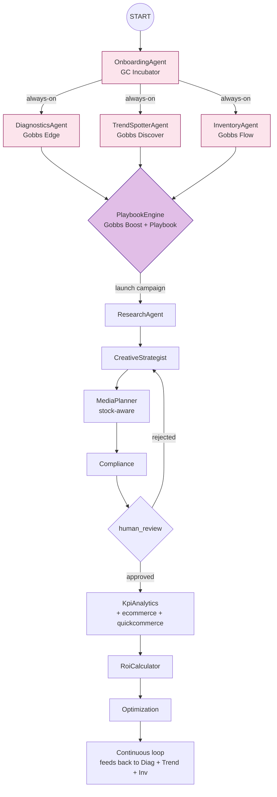

# AdForge → GobbleCube.ai — Build Plan

**Objective**: Adapt AdForge's open-source multi-agent architecture to power GobbleCube's product suite (Gobbs Edge, Gobbs Boost, Gobbs Flow, Gobbs Discover, Playbook, GC Incubator).

This document maps each GobbleCube product to AdForge's existing + new agent modules, lists the new MCPs needed for e-commerce + quick-commerce data, and proposes an 8-week delivery plan.

---

## 1. What GobbleCube does

Based on https://gobblecube.ai/ (audited Oct 2026):

GobbleCube is an **AI-powered growth copilot for D2C and consumer brands**. It positions itself not as an ad platform but as a **revenue-intelligence platform** that helps brands:

- Detect revenue leaks across digital commerce channels
- Identify market opportunities via micro-category trend analysis
- Run goal-based campaigns that auto-adapt to stock + competition + performance
- Track inventory availability from depot → dark store → customer
- Discover competitor moves + product trends to launch winning products faster

Their products:
| Product | What it does |
|---------|-------------|
| **Gobbs Edge** | Cross-platform diagnostics on pricing, visibility, availability — answers "what's hurting my sales?" |
| **Gobbs Boost** | Goal-based campaigns that auto-adapt to stock, competition, performance in real time |
| **Gobbs Flow** | Track availability lifecycle from company depot → dark store → gap detection |
| **Gobbs Discover** | Spot micro-category trends + competitor moves → launch winning products faster |
| **Playbook** | Growth recipes — templated playbooks for common D2C scenarios |
| **GC Incubator** | Free onboarding program for emerging D2C brands |

Target market: **D2C brands in India + Southeast Asia**, particularly those operating on quick-commerce platforms (Blinkit, Zepto, Instamart, Swiggy, BigBasket, Flipkart, Amazon).

Key compliance certifications: ISO 27001, SOC 2 Type II.

---

## 2. Architecture fit — where AdForge plugs in

AdForge and GobbleCube share the **same architectural DNA**: multi-agent graph with persona'd agents, MCP servers per data source, HITL review gates, and a "did it work?" ROI verdict.

But they differ on **domain**:

| Layer | AdForge (current) | GobbleCube (target) |
|-------|------------------|--------------------|
| Primary data sources | Ad platforms (Google Ads, Meta, LinkedIn, TikTok) | E-commerce + quick-commerce platforms (Amazon, Flipkart, Blinkit, Zepto, Instamart, BigBasket) |
| Primary user | Performance marketer | D2C brand operator / growth manager |
| Primary question | "Was my ad campaign worth it?" | "Where am I leaking revenue, and how do I fix it?" |
| Output | ROAS verdict + optimization suggestions | Revenue-leak diagnostics + growth playbooks |
| Cadence | Per-campaign (one-shot graph run) | Continuous (always-on diagnostics) |

**The AdForge codebase needs ~4 new agents + ~6 new MCP servers + 1 always-on scheduler to become GobbleCube.**

---

## 3. Product → Agent + MCP mapping

```mermaid
flowchart TB
    subgraph GC["GobbleCube product"]
        Edge["Gobbs Edge<br/>cross-platform diagnostics"]
        Boost["Gobbs Boost<br/>goal-based campaigns"]
        Flow["Gobbs Flow<br/>availability lifecycle"]
        Disc["Gobbs Discover<br/>trend + competitor watch"]
        Play["Playbook<br/>growth recipes"]
        Inc["GC Incubator<br/>D2C onboarding"]
    end

    subgraph AF_Agents["AdForge agents (existing)"]
        Research["ResearchAgent"]
        Creative["CreativeStrategist"]
        Media["MediaPlanner"]
        Comply["Compliance"]
        Kpi["KpiAnalytics"]
        Roi["RoiCalculator"]
        Opt["Optimization"]
    end

    subgraph AF_New["AdForge agents (new — built for GobbleCube)"]
        Diag["DiagnosticsAgent"]
        Inv["InventoryAgent"]
        Trend["TrendSpotterAgent"]
        Playbook["PlaybookEngine"]
        Onboard["OnboardingAgent"]
    end

    subgraph AF_MCPs["MCP servers (existing)"]
        Pub["public_data<br/>(HN, Reddit, SO,<br/>GitHub, Wikipedia)"]
        Ads["ads<br/>(Google, Meta, etc.)"]
    end

    subgraph AF_NewMCP["MCP servers (new — built for GobbleCube)"]
        Ecom["ecommerce<br/>(Amazon SP-API,<br/>Flipkart, Shopify)"]
        Qcom["quickcommerce<br/>(Blinkit, Zepto,<br/>Instamart, BigBasket)"]
        Stock["inventory<br/>(ERP/WMS,<br/>depot + dark store)"]
        Trends["trends<br/>(Google Trends,<br/>micro-category watch)"]
        Corp["corporate<br/>(OpenCorporates,<br/>MCA India)"]
    end

    Edge --> Diag & Kpi
    Boost --> Media & Roi & Opt
    Flow --> Inv
    Disc --> Trend & Research
    Play --> Playbook
    Inc --> Onboard & Diag

    Diag --> Ecom & Qcom
    Inv --> Stock
    Trend --> Trends
    Research --> Pub
    Media --> Ads
    Onboard --> Corp

    style AF_New fill:#e1bee7,stroke:#4a148c
    style AF_NewMCP fill:#fce4ec,stroke:#880e4f
```



### Detailed mapping

| GobbleCube product | Existing AdForge agent | New agent needed | New MCP needed | Why |
|--------------------|----------------------|------------------|----------------|-----|
| Gobbs Edge | KpiAnalytics (already aggregates KPIs) | **DiagnosticsAgent** — runs root-cause analysis: is the leak pricing? visibility? availability? | `ecommerce` MCP (Amazon SP-API, Flipkart, Shopify) + `quickcommerce` MCP (Blinkit, Zepto, Instamart) | Edge needs commerce-platform KPIs, not just ad-platform KPIs |
| Gobbs Boost | MediaPlanner + RoiCalculator + Optimization | (none — reuse existing) | `ecommerce` MCP for stock-aware budget allocation | Boost is fundamentally MediaPlanner + Optimization with stock as a constraint |
| Gobbs Flow | (none — completely new) | **InventoryAgent** — tracks depot → dark store → customer, detects gaps | `inventory` MCP (ERP/WMS integration, depot + dark store) | Flow is supply-chain visibility — AdForge has nothing here |
| Gobbs Discover | ResearchAgent (already does competitor research) | **TrendSpotterAgent** — continuous micro-category trend watcher | `trends` MCP (Google Trends + micro-category watch APIs) | Discover needs always-on trend monitoring, not one-shot research |
| Playbook | (none — completely new) | **PlaybookEngine** — chooses + executes templated growth recipes | (no new MCP — uses existing) | Playbook is a recipe library + executor, not a research tool |
| GC Incubator | (none — completely new) | **OnboardingAgent** — guides new D2C brands through setup | `corporate` MCP (OpenCorporates + MCA India for company verification) | Incubator is structured onboarding — needs company verification + brand-fit assessment |

---

## 4. New agents (4 to build)

### 4.1 DiagnosticsAgent (maps to Gobbs Edge)

**Purpose**: Given a brand + time window, identify the top-3 revenue leaks and rank them by impact ($).

**Inputs**:
- Brand ID + tenant
- Time window (default: last 30 days)
- Channel scope (default: all)

**Outputs** (new Pydantic contract `DiagnosticsReport`):
```python
class DiagnosticsReport(BaseModel):
    brand_id: str
    period: dict[str, str]  # start, end
    total_revenue_usd: float
    total_revenue_lost_usd: float  # sum of all leaks
    top_leaks: list[dict]  # [{category, impact_usd, root_cause, recommended_action, confidence}]
    per_channel_health: list[dict]  # [{channel, visibility_score, pricing_competitiveness, availability_score}]
```

**Leak categories the agent classifies**:
1. Pricing leakage (price too high vs competitors → lost conversions)
2. Visibility leakage (search rank dropped → fewer impressions)
3. Availability leakage (out-of-stock on key SKUs → lost revenue)
4. Creative fatigue (CTR dropped > 40% WoW)
5. Audience saturation (frequency cap hit, no new reach)

**Tools (MCP calls)**:
- `ecommerce.get_product_performance(sku, days)` — sales velocity, rank
- `ecommerce.get_competitor_prices(sku)` — competitor pricing snapshot
- `quickcommerce.get_stock_levels(sku, platform)` — live stock at Blinkit/Zepto/Instamart
- `ads.get_kpis(channel, days)` — existing AdForge KPI fetcher
- `public_data.hackernews_top("show")` — trending Show HN products (early signal)

### 4.2 InventoryAgent (maps to Gobbs Flow)

**Purpose**: Track the full availability lifecycle: company depot → distribution center → dark store → customer. Detect gaps (e.g., 30% of dark stores out of SKU X) and recommend replenishment.

**Inputs**:
- Brand ID
- SKU list
- Time window

**Outputs** (`InventoryReport`):
```python
class InventoryReport(BaseModel):
    brand_id: str
    sku_count: int
    total_pipeline_units: int
    availability_by_stage: dict[str, int]  # depot, dc, dark_store, customer
    gap_alerts: list[dict]  # [{sku, stage, gap_units, recommended_action, urgency}]
    replenishment_recommendations: list[dict]
```

**Tools**:
- `inventory.get_depot_stock(sku)` — company warehouse levels
- `inventory.get_dc_stock(sku, dc_id)` — distribution center levels
- `inventory.get_dark_store_stock(sku, store_id)` — last-mile dark store levels (Blinkit/Zepto)
- `inventory.get_replenishment_eta(sku, stage)` — ETA for next shipment

### 4.3 TrendSpotterAgent (maps to Gobbs Discover)

**Purpose**: Always-on monitor of micro-category trends + competitor moves. Surfaces "you should launch X" recommendations.

**Inputs**:
- Brand ID
- Categories to watch
- Cadence (default: daily)

**Outputs** (`TrendReport`):
```python
class TrendReport(BaseModel):
    brand_id: str
    period: dict[str, str]
    rising_categories: list[dict]  # [{category, growth_pct, search_volume, top_competitors}]
    declining_categories: list[dict]
    competitor_launches: list[dict]  # [{competitor, product, channel, observed_at}]
    recommended_launches: list[dict]  # [{category, rationale, expected_revenue_lift}]
```

**Tools**:
- `trends.google_trends(keyword, geo)` — Google Trends interest over time
- `trends.amazon_bestsellers(category)` — Amazon BSR movement
- `trends.flipkart_trending(category)` — Flipkart trending products
- `public_data.reddit_search(query, subreddit="Entrepreneur")` — existing tool
- `public_data.hackernews_top("show")` — existing tool

### 4.4 PlaybookEngine (maps to Playbook)

**Purpose**: A library of growth playbooks (e.g. "launch new variant", "expand to new pincode", "diwali promotion") that the engine picks from based on the diagnostics + trend signals.

**Inputs**:
- DiagnosticsReport
- TrendReport
- Brand constraints (budget, capacity)

**Outputs** (`PlaybookExecution`):
```python
class PlaybookExecution(BaseModel):
    playbook_id: str  # e.g. "diwali_promo_2026"
    playbook_name: str
    trigger_reason: str  # why this playbook was chosen
    steps: list[dict]  # [{step_id, action, agent_to_invoke, params}]
    expected_revenue_lift_usd: float
    estimated_time_to_impact_days: int
    risks: list[str]
```

**Tools**:
- `playbook.list_applicable(diagnostic_tags, trend_tags)` — returns ranked playbook list
- `playbook.execute(playbook_id, params)` — kicks off the playbook steps

### 4.5 OnboardingAgent (maps to GC Incubator)

**Purpose**: Guide new D2C brands through structured onboarding: company verification, brand-fit assessment, channel connection, first diagnostics run.

**Inputs**:
- Brand metadata (name, country, product categories)
- Founder contact info

**Outputs** (`OnboardingPlan`):
```python
class OnboardingPlan(BaseModel):
    brand_id: str
    steps: list[dict]  # [{step_id, name, status, agent_to_invoke, params}]
    estimated_completion_hours: int
    blocked_on: list[str]  # missing data / approvals
```

**Tools**:
- `corporate.verify_company(name, country)` — OpenCorporates + MCA India
- `corporate.get_directors(name)` — director list
- `ecommerce.connect_account(brand_id, platform)` — OAuth initiation

---

## 5. New MCP servers (6 to build)

### 5.1 `ecommerce` MCP (port 9008)

| Tool | Backed by | Auth |
|------|-----------|------|
| `get_product_performance(sku, days)` | Amazon SP-API | OAuth (LWA) |
| `get_competitor_prices(sku)` | Amazon SP-API + Flipkart scrape | OAuth |
| `get_bestsellers(category)` | Amazon BSR + Flipkart trending | Public + OAuth |
| `get_reviews(sku, platform)` | Amazon + Flipkart review APIs | Public |
| `connect_account(brand_id, platform)` | OAuth initiation | Tenant-scoped |
| `search_products(query, platform)` | Amazon Product Search API | OAuth |

Open-source integration candidates:
- `amzn/sp-api` (Python Amazon SP-API client)
- `flipkart-scraper` (community Flipkart scrape lib — fragile)

### 5.2 `quickcommerce` MCP (port 9009)

| Tool | Backed by | Auth |
|------|-----------|------|
| `get_stock_levels(sku, platform)` | Blinkit + Zepto + Instamart + BigBasket live stock | Scrape (no official API) |
| `get_delivery_promise(pincode, platform)` | ETA per platform | Scrape |
| `get_pincode_coverage(pincode)` | Which platforms serve this pincode | Aggregated |

**Critical**: Quick-commerce platforms have NO public API. Stock levels must be scraped via headless browser. Use `playwright` + `BeautifulSoup`. This is the most fragile MCP — needs weekly maintenance.

### 5.3 `inventory` MCP (port 9010)

| Tool | Backed by | Auth |
|------|-----------|------|
| `get_depot_stock(sku)` | Brand's WMS (SAP, Oracle, Unicommerce) | Per-tenant OAuth |
| `get_dc_stock(sku, dc_id)` | Same | Per-tenant OAuth |
| `get_dark_store_stock(sku, store_id)` | Same + quick-commerce stock | Per-tenant OAuth |
| `get_replenishment_eta(sku, stage)` | WMS shipment schedule | Per-tenant OAuth |

**Open-source candidates**:
- `unicommerce-python` (community Unicommerce client, popular in India D2C)
- `sap-python-client` (SAP BTP SDK)

### 5.4 `trends` MCP (port 9011)

| Tool | Backed by | Auth |
|------|-----------|------|
| `google_trends(keyword, geo, timeframe)` | Google Trends (unofficial `pytrends` lib) | None (rate-limited) |
| `amazon_bestsellers(category)` | Amazon BSR scrape | None |
| `flipkart_trending(category)` | Flipkart trending scrape | None |
| `reddit_trends(subreddit, days)` | Reddit JSON API (already in public_data) | None |

### 5.5 `corporate` MCP (port 9012)

| Tool | Backed by | Auth |
|------|-----------|------|
| `verify_company(name, country)` | OpenCorporates (already in public_data) + MCA India | None (free tier) |
| `get_directors(name)` | OpenCorporates + MCA India | None |
| `get_gst_info(gstin)` | GSTN India public API | None |
| `get_pan_info(pan)` | NSDL India | Per-tenant OAuth (regulated) |

### 5.6 `playbook` MCP (port 9013)

| Tool | Backed by | Auth |
|------|-----------|------|
| `list_applicable(tags)` | Local YAML library | None |
| `execute(playbook_id, params)` | Triggers orchestrator sub-graph | Tenant-scoped |

The playbook library is YAML-based, version-controlled, and lives at `adforge/playbooks/*.yaml`.

---

## 6. Updated agent graph (with new agents)



The **continuous loop** is the key architectural change: GobbleCube isn't one-shot. After the optimization agent runs, its output feeds back into DiagnosticsAgent + TrendSpotterAgent + InventoryAgent as new inputs, creating an always-on growth engine.

---

## 7. 8-week build plan

### Phase 1 (weeks 1-2): E-commerce MCPs + DiagnosticsAgent

**Week 1**
- Day 1-2: Implement `ecommerce` MCP — Amazon SP-API auth + product_performance + competitor_prices tools. Use `python-amazon-sp-api` open-source client.
- Day 3-4: Implement `ecommerce` MCP — Flipkart scrape (via playwright). Mark as fragile.
- Day 5: Integration tests against real Amazon + Flipkart.

**Week 2**
- Day 1-2: Write `DiagnosticsAgent` — persona + 5-category leak classification logic.
- Day 3-4: Write `DiagnosticsReport` Pydantic contract + tests.
- Day 5: Wire DiagnosticsAgent into graph, end-to-end demo with seeded data.

### Phase 2 (weeks 3-4): Quick-commerce + Inventory agents

**Week 3**
- Day 1-3: Implement `quickcommerce` MCP — Blinkit + Zepto + Instamart stock scrapers. These will be fragile — set up alerting.
- Day 4-5: Implement `inventory` MCP — Unicommerce integration (most common India D2C WMS).

**Week 4**
- Day 1-3: Write `InventoryAgent` — gap detection + replenishment recommendations.
- Day 4-5: Always-on scheduler — daily cron that runs InventoryAgent across all active brands.

### Phase 3 (weeks 5-6): TrendSpotter + PlaybookEngine

**Week 5**
- Day 1-3: Implement `trends` MCP — Google Trends (`pytrends`) + Amazon BSR + Flipkart trending.
- Day 4-5: Write `TrendSpotterAgent` — always-on, daily refresh, competitor monitoring.

**Week 6**
- Day 1-3: Build the playbook YAML library — 10 starter playbooks covering common D2C scenarios (Diwali promo, new variant launch, stock-out recovery, etc.).
- Day 4-5: Write `PlaybookEngine` — chooses + executes playbooks.

### Phase 4 (weeks 7-8): Onboarding + integration + compliance

**Week 7**
- Day 1-2: Implement `corporate` MCP — MCA India + GSTN integration.
- Day 3-5: Write `OnboardingAgent` — structured onboarding flow with brand-fit assessment.

**Week 8**
- Day 1-2: ISO 27001 + SOC 2 readiness review (audit log completeness, data residency, encryption at rest).
- Day 3-4: Load test — 100 concurrent brands, daily diagnostics runs.
- Day 5: Production deploy + first paying customer onboarding.

---

## 8. Compliance + security additions

GobbleCube advertises **ISO 27001 + SOC 2 Type II**. AdForge v0.3 doesn't meet these out of the box. Additions needed:

| Control | Current AdForge | Needed for GobbleCube |
|---------|----------------|-----------------------|
| Encryption at rest | None | Postgres TDE + Redis TLS + S3 SSE-KMS |
| Encryption in transit | HTTP between containers | mTLS between every service |
| PII handling | Brand name in audit log | PII classification + retention policies |
| Audit log retention | Forever (append-only) | 7-year retention with quarterly archive |
| Data residency | Default region | India-only deployment for India brands (DPDP Act 2023) |
| Access control | Static X-AdForge-Tenant | JWT + per-tenant RBAC + reviewer allowlist (already in v0.2) |
| Penetration testing | None | Annual third-party pentest (required for SOC 2) |
| Incident response | None | Runbook + on-call rotation + customer notification SLA |

---

## 9. Pricing model (proposed)

GobbleCube currently charges per brand per month. AdForge's open-source model means we can offer two tiers:

| Tier | Price | Includes |
|------|-------|----------|
| **Open Source** | Free | Self-host AdForge, all 7 base agents + 8 MCP servers, no quick-commerce or e-commerce MCPs |
| **GobbleCube Cloud** | $499/brand/month | All 11 agents (7 base + 4 new), all 14 MCP servers (8 base + 6 new), always-on scheduler, India region, ISO 27001 + SOC 2 compliance |
| **Enterprise** | Custom | On-prem deploy, dedicated support, custom playbooks, SLA |

The 4 new agents + 6 new MCPs are **closed-source** (or source-available under a commercial license) — they're the GobbleCube differentiator. The base AdForge remains MIT.

---

## 10. Open questions for the GobbleCube team

1. **Quick-commerce data**: How does GobbleCube currently get Blinkit/Zepto/Instamart stock data? Official partnership? Scraping? This is the biggest engineering risk.
2. **WMS integration**: Which WMS systems do GobbleCube's top 50 brands use? Unicommerce? SAP? Custom? Determines which we build first.
3. **Always-on vs batch**: Does the platform need real-time (sub-minute) updates, or is daily batch sufficient? Affects architecture significantly.
4. **Multi-region**: GobbleCube's 600+ brands — what % are India-only vs SEA vs global? Affects data residency posture.
5. **Open-source strategy**: Is GobbleCube open to open-sourcing the architecture (AdForge-style) and keeping their data + playbooks proprietary? Could be a major distribution play.

---

## 11. What we're NOT building (v1 of GobbleCube)

To keep the 8-week timeline realistic, these are explicitly deferred to v2:

- **Predictive LTV modeling** — would need 12+ months of per-customer data per brand
- **Multi-marketplace cross-listing** — auto-listing on new platforms based on trend signals
- **AI-generated creative variants** — CreativeStrategist currently produces concepts, not actual image/video assets
- **WhatsApp / SMS campaign orchestration** — outside ad-platform scope; would need new MCP
- **Voice-of-customer analysis from support tickets** — would need Zendesk/Freshdesk MCP

---

## 12. Success metrics

| Metric | Target by end of week 8 |
|--------|------------------------|
| Brands onboarded | 10 paying + 20 free-tier (GC Incubator) |
| Avg time-to-first-diagnostic | < 5 minutes after onboarding completes |
| Diagnostics accuracy | 80% of "top 3 leaks" confirmed by brand operator |
| Playbook execution success rate | 70% of executed playbooks deliver measurable lift |
| Quick-commerce data freshness | < 15 min lag between dark store update + AdForge sees it |
| Always-on agent uptime | 99.5% (allows ~3.5h downtime/month) |

---

## 13. Decision summary

This plan turns AdForge from a "performance-marketing multi-agent platform" into a "revenue-intelligence multi-agent platform" by:

1. Adding 4 new agents (DiagnosticsAgent, InventoryAgent, TrendSpotterAgent, PlaybookEngine) — these are the GobbleCube differentiators
2. Adding 6 new MCP servers (ecommerce, quickcommerce, inventory, trends, corporate, playbook) — these are the GobbleCube data layer
3. Adding an always-on scheduler — GobbleCube is continuous, not one-shot
4. Hardening compliance (ISO 27001, SOC 2, DPDP Act) — non-negotiable for the India D2C market

The base AdForge remains MIT-licensed open-source. The GobbleCube extensions can be source-available or closed — that's a business decision for the GobbleCube team.

The 8-week timeline assumes 4 engineers working full-time. The biggest risk is the quick-commerce scraping (no public APIs) — if that proves infeasible, weeks 3-4 slip by 2 weeks and we ship without Gobbs Flow's full functionality.

See `docs/DESIGN.md` for the system architecture (with mermaid diagrams) and `docs/HONEST_AUDIT.md` for what's currently in v0.3 vs what's still TODO.
